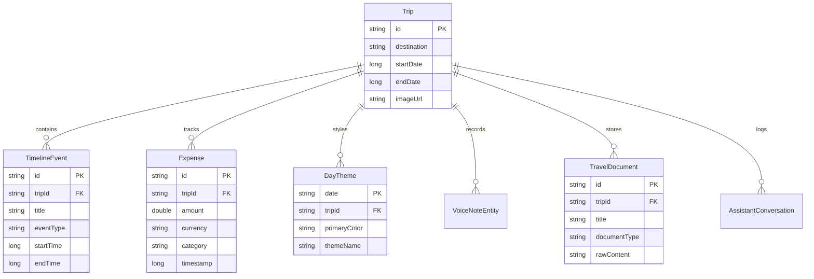
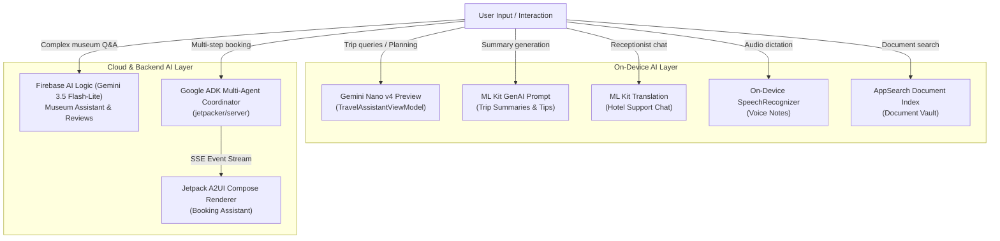

# JetPacker Architecture

JetPacker is an AI-first travel companion application designed for Android, demonstrating on-device machine learning (ML Kit and Gemini Nano), cloud AI reasoning (Firebase AI Logic), dynamic agent-driven UI (Jetpack A2UI), and Android system intelligence integration ([AppFunctions](https://d.android.com/ai/appfunctions)).

---

## 1. High-Level Subsystem Architecture

```mermaid
graph TD
    App[":app Application Shell"]
    
    subgraph UI_Features["Feature Modules (:feature:*)"]
        Home[":feature:home"]
        CreateTrip[":feature:create_trip"]
        TripShell[":feature:trip"]
        Itinerary[":feature:trip:itinerary"]
        Expenses[":feature:trip:expenses"]
        VoiceNotes[":feature:trip:voice_notes"]
        BookingAssistant[":feature:trip:booking_assistant"]
        Detail[":feature:detail"]
        Museum[":feature:detail:museum_assistant"]
        Review[":feature:detail:review"]
        HotelChat[":feature:detail:hotel_chat"]
        Assistant[":feature:assistant (Travel Assistant & Document Vault)"]
        AppFunctions[":feature:appfunctions (Android AppFunctions Service)"]
    end

    subgraph Data_Layer["Data Modules (:data:*)"]
        DataTrips[":data:trips (Trip Repository & Entity)"]
        DataItinerary[":data:itinerary (Timeline, Expenses, Docs, Themes)"]
        DataDb[":data:db (Room Database v4 & DAOs)"]
    end

    subgraph Core_Layer["Core Modules (:core:*)"]
        CoreUI[":core:ui (Design System, Tokens, Components)"]
        CoreFlags[":core:flags (Feature Toggles)"]
        CoreSpeech[":core:speech (On-Device Speech-to-Text)"]
    end

    subgraph Backend_Server["Backend Services (jetpacker/server)"]
        FastAPIServer["FastAPI Server + SSE Streaming"]
        ADKAgents["Google ADK Multi-Agent Coordinator"]
    end

    App --> UI_Features
    TripShell --> Itinerary
    TripShell --> Expenses
    TripShell --> VoiceNotes
    TripShell --> BookingAssistant
    Detail --> Museum
    Detail --> Review
    Detail --> HotelChat

    UI_Features --> DataTrips
    UI_Features --> DataItinerary
    UI_Features --> CoreUI
    UI_Features --> CoreFlags
    UI_Features --> CoreSpeech

    DataTrips --> DataDb
    DataItinerary --> DataDb
    AppFunctions --> DataDb
    Assistant --> DataDb

    BookingAssistant -.->|"SSE / Streaming (REST)"| FastAPIServer
    FastAPIServer --> ADKAgents
```

---

## 2. Module Directory Map

| Layer | Module Path | Gradle Target | Key Responsibilities |
| :--- | :--- | :--- | :--- |
| **Application** | `android/app` | `:app` | Application entry point, Hilt dependency graph, root navigation compose host, theme provider. |
| **Features** | `android/feature/home` | `:feature:home` | Home dashboard, list of active and past trips, quick trip actions. |
| | `android/feature/create_trip` | `:feature:create_trip` | Dialogs and forms for creating new trips or editing existing destinations and dates. |
| | `android/feature/trip` | `:feature:trip` | Top-level trip shell holding bottom navigation bar across Itinerary, Expenses, Notes, and Booking. |
| | `android/feature/trip/itinerary` | `:feature:trip:itinerary` | Timeline view of daily itinerary events, event chips, and AI trip summaries. |
| | `android/feature/trip/expenses` | `:feature:trip:expenses` | Expense logging, category budgeting, currency conversions, and receipt OCR scanning. |
| | `android/feature/trip/voice_notes` | `:feature:trip:voice_notes` | On-device voice recorder with real-time speech-to-text transcription. |
| | `android/feature/trip/booking_assistant` | `:feature:trip:booking_assistant` | Jetpack A2UI dynamic UI rendering for flight/hotel option cards, seat selection, and booking flows. |
| | `android/feature/detail` | `:feature:detail` | Base detail screens for flights, hotels, restaurants, and museums. |
| | `android/feature/detail/museum_assistant` | `:feature:detail:museum_assistant` | Grounded museum chatbot using Gemini 3.5 flash-lite with Google Maps/Search grounding. |
| | `android/feature/detail/review` | `:feature:detail:review` | AI-assisted review drafting with topic chips and star rating evaluation. |
| | `android/feature/detail/hotel_chat` | `:feature:detail:hotel_chat` | Real-time bilingual chat with hotel reception using ML Kit on-device translation. |
| | `android/feature/assistant` | `:feature:assistant` | On-device Travel Assistant (Gemini Nano v4 Preview + Room DAO tool binding), Document Vault, and Chat History. |
| | `android/feature/appfunctions` | `:feature:appfunctions` | Android system intelligence integration via `androidx.appfunctions` exposing trips, expenses, documents, and notes. |
| **Data Layer** | `android/data/db` | `:data:db` | `JetPackerDatabase` (Room v4, 13 entities), Hilt database module, type converters. |
| | `android/data/trips` | `:data:trips` | `Trip` model, `TripDao`, and reactive repository. |
| | `android/data/itinerary` | `:data:itinerary` | `TimelineEvent`, `Expense`, `TravelDocument`, `DayTheme`, `VoiceNoteEntity` models and DAOs. |
| **Core Layer** | `android/core/ui` | `:core:ui` | Reusable Compose components (`JetPackerToolbar`, `JetPackerFab`), typography, and color tokens. |
| | `android/core/flags` | `:core:flags` | `FeatureFlags` controlling runtime feature toggles and AI model fallbacks. |
| | `android/core/speech` | `:core:speech` | On-device speech recognition utilities and audio recorder abstractions. |
| **Backend** | `jetpacker/server` | N/A (Python) | FastAPI server hosting Google ADK agents (Flight, Hotel, Activity, Orchestrator) with SSE streaming for A2UI. |

---

## 3. Data Storage & Persistence (`:data:db`)

JetPacker uses Room Database (`JetPackerDatabase`, schema version 4) as the single source of truth for all local trip records.

### Database Entities & DAOs

- **`TripDao`**: Reactive Flow streams (`getAllTrips()`, `getTrip(id)`), inserts, and deletions.
- **`EventDao`**: Timeline events and specialized details (`FlightDetail`, `HotelDetail`, `DiningDetail`, `MuseumDetail`, `ActivityDetail`).
- **`ExpenseDao`**: Expense records and aggregate queries.
- **`TravelDocumentDao`**: On-device travel vouchers, boarding passes, and email receipts.
- **`AssistantConversationDao`**: Serialized conversation logs for travel assistant chat history.

---

## 4. AI & Agent Subsystems

JetPacker implements a hybrid, multi-tier AI architecture balancing low-latency on-device processing with complex cloud orchestration:

### 1. Travel Assistant (`TravelAssistantViewModel.kt`)
- Runs locally via **Gemini Nano v4 Preview** with automated download management.
- Directly binds pruned Room DAO tools (`TravelDaoAgentTool`) allowing the model to query live database trips and itineraries dynamically without token overhead.
- Pruned tool definitions save ~1,200 tokens per inference turn.

### 2. Booking Assistant & Jetpack A2UI
- Uses **Jetpack A2UI** (`androidx.a2ui`) to dynamically render interactive UI cards streamed from the backend.
- The Python backend runs Google Agent Development Kit (ADK) agents that negotiate flight, hotel, and activity options and emit JSON A2UI payloads over Server-Sent Events (SSE).

### 3. Document Vault & Semantic Search
- Combines on-device OCR / Vision scanning with Android **AppSearch** for fast, offline, privacy-first retrieval of boarding passes, tickets, and booking confirmations.

---

## 5. System Intelligence Integration (`:feature:appfunctions`)

JetPacker exposes its core capabilities to the Android OS and external assistant surfaces using the `androidx.appfunctions` framework:

- **Service**: `JetPackerAppFunctionService` (annotated with `@AppFunctionService`).
- **Exposed Functions**:
  - `getTrips`, `createTrip`, `updateTrip`
  - `getTimelineEvents`, `addTimelineEvent`
  - `getExpenses`, `addExpense`
  - `getVoiceNotes`, `addVoiceNote`
  - `searchTravelDocuments`, `getTravelDocumentDetails`
  - `getDayThemes`, `setDayTheme`
- **Serialization**: Custom serializable types (`TripSerializable`, `ExpenseSerializable`, `TimelineEventSerializable`) with generated `@AppFunctionSerializable` factories.
